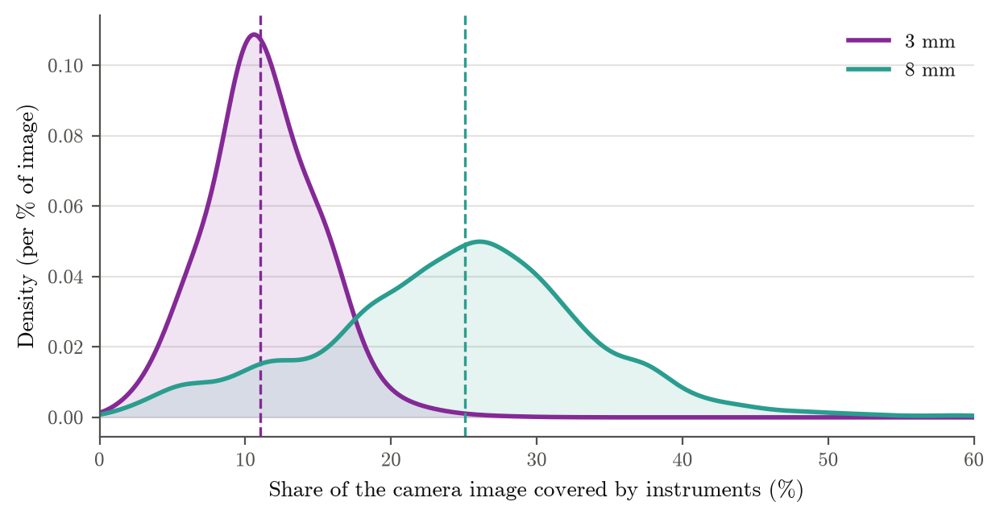
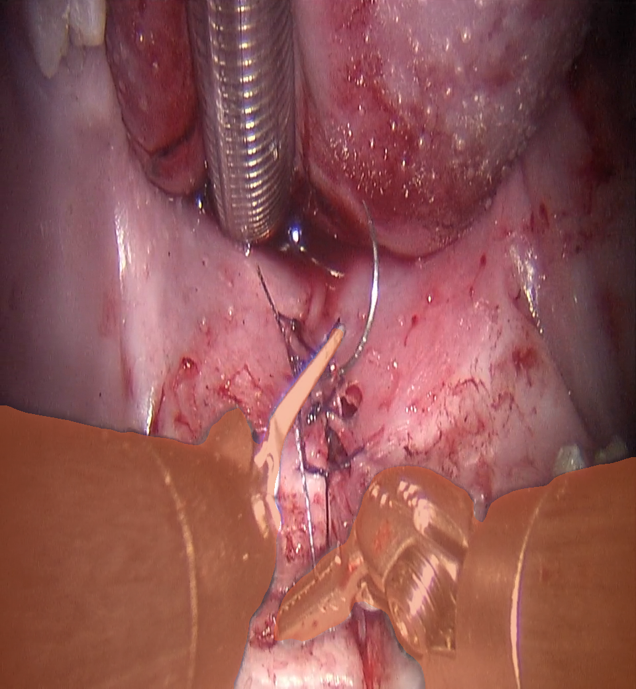
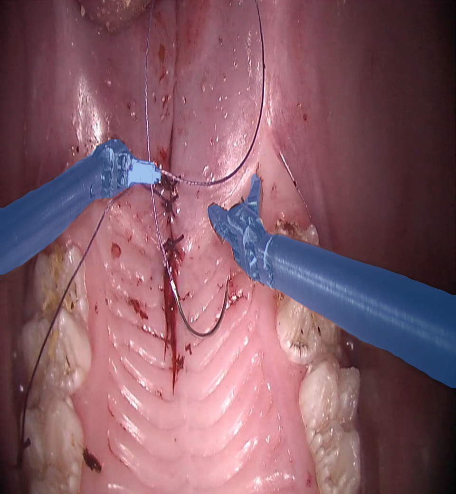
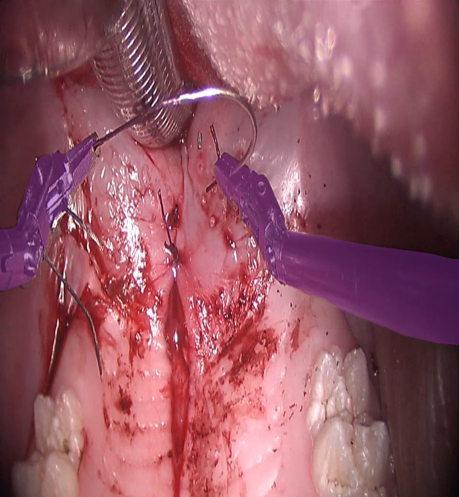

# Visual field figures

Written by `scripts/occlusion_figures.py`; re-run it to update the images and numbers.

## Occlusion distribution

**Instrument occlusion of the camera view, 3 mm vs 8 mm tools.** Share of the left-eye camera image covered by the robotic instruments, per video frame (1 frame per second, frames with instruments in view), shown as a probability density (Gaussian kernel 1.5 points wide; the area under each curve is 1). Purple: 3 mm (3 pigs, 28,822 frames). Teal: 8 mm (4 pigs, 21,102 frames). Dashed lines: medians, 11.0% (3 mm) and 25.1% (8 mm). Median of the per-pig medians: 3 mm 10.4% (range 10.2-11.3%), 8 mm 23.9% (range 22.9-26.5%). Instruments were segmented with a DeepLabV3 model trained on 120 hand-labelled frames.

Vector version: [occlusion_distribution.pdf](occlusion_distribution.pdf)

## Example frames

**8 mm tools during suturing.** Instrument mask shaded (teal); 30% of the image is covered. Source: `pig_oct07-2026-10-07_14.31.12.mp4` at 6462 s, left eye; picked by eye from Oct 7 frames at 26-27% (per-second values).

**3 mm tools during suturing.** Instrument mask shaded (purple); 11% of the image is covered. Source: `pig_may29-2026-05-29_09.34.18.mp4` at 6127 s, left eye; picked by eye from 3 mm frames at 10-12% (per-second values).

## Backup example

**3 mm tools during suturing.** Instrument mask shaded (purple); 10% of the image is covered. Source: `pig_jun15-2026-06-15_10.14.18.mp4` at 4828 s, left eye; backup for the 3 mm example; picked by eye from 3 mm frames at 10-12%.
