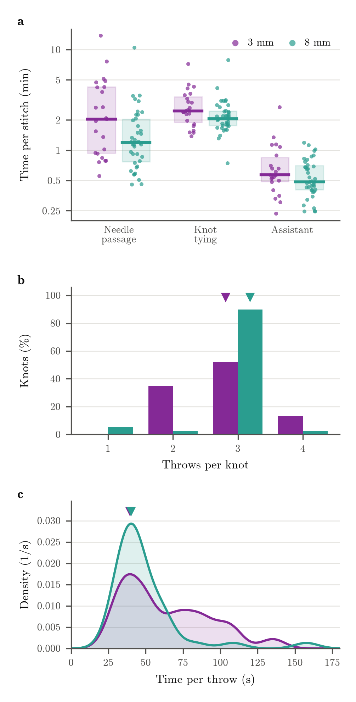

# Suture figure (draft)

Written by `scripts/suture_figure.py`.

**Suturing with 3 mm and 8 mm instruments.** (a) Time per stitch in each phase: needle passage (stitch start to needle through), knot tying (needle through to knot tightened) and assistant (knot tightened to cut). Each dot is one completed stitch; boxes show the interquartile range and lines the median. Logarithmic time axis. (b) Share of knots by number of throws; triangles mark the most common count (3 for 3 mm, 3 for 8 mm). (c) Time per throw (knot tying time divided by throws), shown as a probability density (Gaussian kernel 8 s wide; area under each curve is 1); triangles mark the main peak (39 s for 3 mm, 40 s for 8 mm). Purple: 3 mm (23 stitches, 23 knots counted, 3 pigs). Teal: 8 mm (39 stitches, 39 knots counted, 4 pigs). One 3 mm assistant time (P01) is left out as an outlier.

Vector version: [suture_figure.pdf](suture_figure.pdf)
