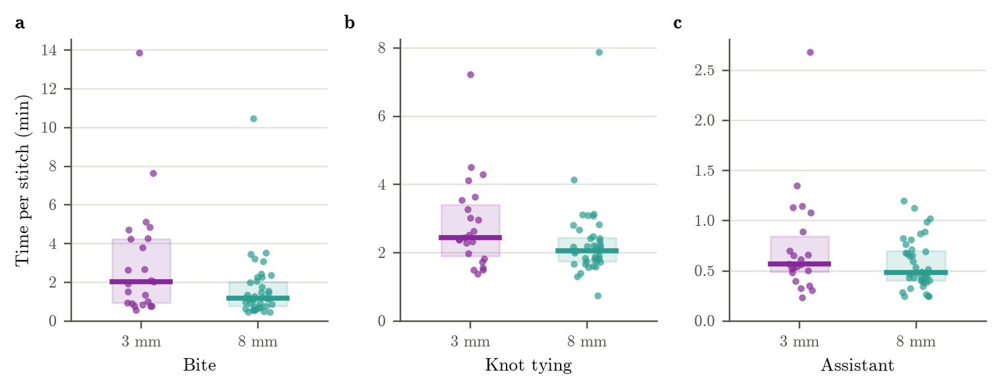

# Stitch phase times

Written by `scripts/phase_times.py`; re-run it after new annotations.

**Stitch phase times, 3 mm vs 8 mm.** (a) Bite: stitch start to needle through. (b) Knot tying: needle through to knot tightened. (c) Assistant: knot tightened to cut by the surgical assistant. Each dot is one completed stitch; boxes show the interquartile range and thick lines the median. Purple: 3 mm (up to 23 stitches, 3 pigs). Teal: 8 mm (39 stitches, 4 pigs). One 3 mm assistant time (P01) is left out as an outlier.

## Median (IQR), minutes

| phase | 3 mm | 8 mm |
|---|---|---|
| Bite | 2.0 (0.9-4.2), n = 23 | 1.2 (0.8-2.0), n = 39 |
| Knot tying | 2.5 (1.9-3.4), n = 23 | 2.1 (1.8-2.5), n = 39 |
| Assistant | 0.6 (0.5-0.8), n = 22 | 0.5 (0.4-0.7), n = 39 |

All completed stitches of a system pooled. Cases: 3 mm P01, P02, P03; 8 mm P04, P05, P06, P07.
