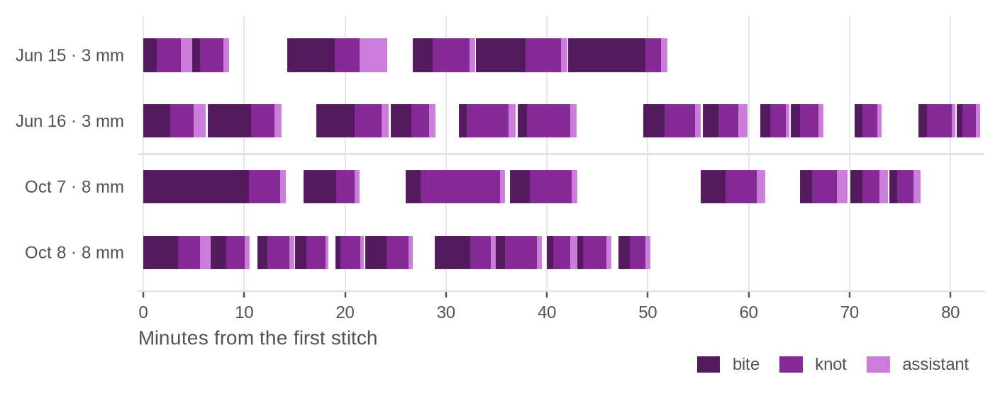
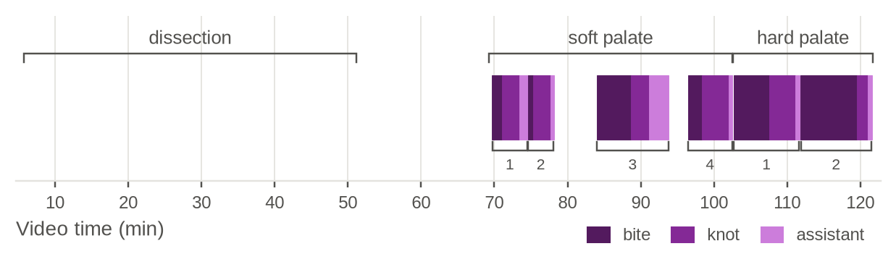
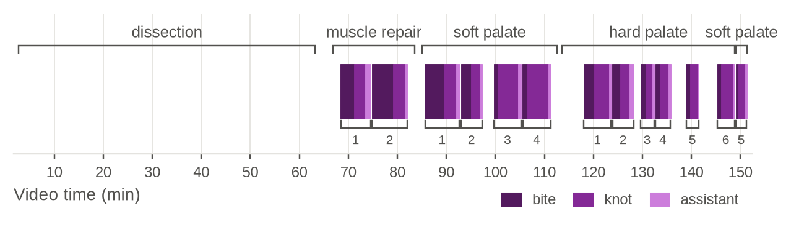
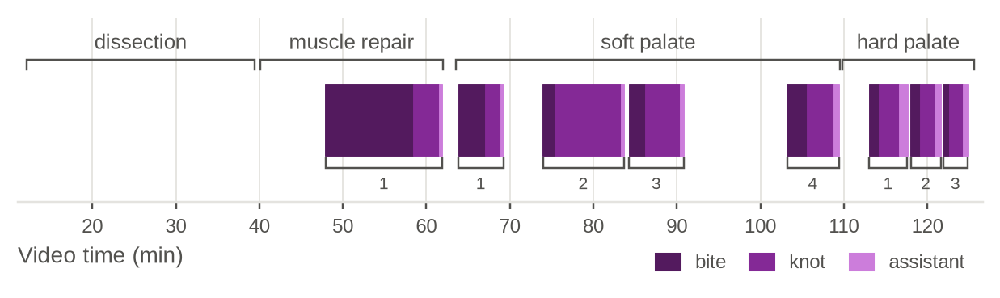
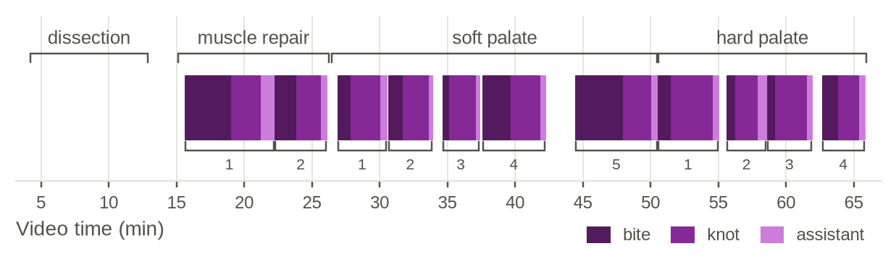

# Suture timing (draft)

Written by `scripts/suture_times.py` from `results/annotations/`; re-run it after new annotations.

## All pigs

**Stitch timelines, 3 mm vs 8 mm.** One row per pig, aligned at its first stitch. Each bar is one stitch, split into bite (dark purple, needle first touches tissue to needle through), knot (purple, needle through to last throw tightened) and assistant (light purple, tightened to the assistant's cut).

## Jun 15 (`pig_jun15-2026-06-15_10.14.18`)

**Procedure timeline.** Brackets above: annotated phases. Each bar is one stitch, split into bite (dark purple, needle first touches tissue to needle through), knot (purple, needle through to last throw tightened) and assistant (light purple, tightened to the assistant's cut). Brackets below: each whole stitch, from the needle first touching tissue to the assistant's cut, numbered within each phase. (Stitch time in the tables is start to knot tightened.)

## Jun 16 (`pig_jun16-2026-06-16_09.57.53`)

**Procedure timeline.** Brackets above: annotated phases. Each bar is one stitch, split into bite (dark purple, needle first touches tissue to needle through), knot (purple, needle through to last throw tightened) and assistant (light purple, tightened to the assistant's cut). Brackets below: each whole stitch, from the needle first touching tissue to the assistant's cut, numbered within each phase. (Stitch time in the tables is start to knot tightened.)

## Oct 7 (`pig_oct07-2026-10-07_14.31.12`)

**Procedure timeline.** Brackets above: annotated phases. Each bar is one stitch, split into bite (dark purple, needle first touches tissue to needle through), knot (purple, needle through to last throw tightened) and assistant (light purple, tightened to the assistant's cut). Brackets below: each whole stitch, from the needle first touching tissue to the assistant's cut, numbered within each phase. (Stitch time in the tables is start to knot tightened.)

## Oct 8 (`pig_oct08-2026-10-08_13.19.52`)

**Procedure timeline.** Brackets above: annotated phases. Each bar is one stitch, split into bite (dark purple, needle first touches tissue to needle through), knot (purple, needle through to last throw tightened) and assistant (light purple, tightened to the assistant's cut). Brackets below: each whole stitch, from the needle first touching tissue to the assistant's cut, numbered within each phase. (Stitch time in the tables is start to knot tightened.)

## Summary per measure (seconds)

| block | measure | n | mean | SD | median | min | max |
|---|---|---|---|---|---|---|---|
| all blocks | stitch | 38 | 282 | 146 | 234 | 116 | 815 |
| all blocks | bite | 38 | 131 | 124 | 85 | 28 | 628 |
| all blocks | knot | 38 | 151 | 71 | 134 | 82 | 473 |
| all blocks | assistant | 38 | 37 | 25 | 30 | 14 | 161 |
| all blocks | gap | 34 | 143 | 156 | 69 | 27 | 766 |
| muscle repair | stitch | 5 | 411 | 237 | 338 | 203 | 815 |
| muscle repair | bite | 5 | 269 | 209 | 208 | 94 | 628 |
| muscle repair | knot | 5 | 141 | 28 | 137 | 109 | 186 |
| muscle repair | assistant | 5 | 44 | 19 | 37 | 27 | 69 |
| muscle repair | gap | 5 | 122 | 76 | 86 | 62 | 248 |
| soft palate | stitch | 18 | 288 | 111 | 300 | 116 | 561 |
| soft palate | bite | 18 | 114 | 74 | 102 | 28 | 283 |
| soft palate | knot | 18 | 174 | 92 | 141 | 82 | 473 |
| soft palate | assistant | 18 | 38 | 33 | 29 | 15 | 161 |
| soft palate | gap | 17 | 190 | 201 | 69 | 30 | 766 |
| hard palate | stitch | 15 | 232 | 129 | 176 | 137 | 553 |
| hard palate | bite | 15 | 105 | 117 | 61 | 35 | 460 |
| hard palate | knot | 15 | 127 | 40 | 109 | 90 | 213 |
| hard palate | assistant | 15 | 33 | 14 | 30 | 14 | 61 |
| hard palate | gap | 12 | 87 | 72 | 61 | 27 | 242 |

## Blocks

| video | block | duration (s) | stitches | time stitching (%) |
|---|---|---|---|---|
| pig_jun15-2026-06-15_10.14.18 | soft palate | 2001 | 4 | 59 |
| pig_jun15-2026-06-15_10.14.18 | hard palate | 1150 | 2 | 92 |
| pig_jun16-2026-06-16_09.57.53 | muscle repair | 1005 | 2 | 69 |
| pig_jun16-2026-06-16_09.57.53 | soft palate | 1663 | 5 | 80 |
| pig_jun16-2026-06-16_09.57.53 | hard palate | 2124 | 6 | 55 |
| pig_jun16-2026-06-16_09.57.53 | soft palate | 147 | 5 | 909 |
| pig_oct07-2026-10-07_14.31.12 | muscle repair | 1314 | 1 | 62 |
| pig_oct07-2026-10-07_14.31.12 | soft palate | 2765 | 4 | 57 |
| pig_oct07-2026-10-07_14.31.12 | hard palate | 952 | 3 | 56 |
| pig_oct08-2026-10-08_13.19.52 | muscle repair | 672 | 2 | 81 |
| pig_oct08-2026-10-08_13.19.52 | soft palate | 1447 | 5 | 76 |
| pig_oct08-2026-10-08_13.19.52 | hard palate | 926 | 4 | 78 |

## Stitches (seconds)

| block | number | stitch | bite | knot | assistant | gap to next |
|---|---|---|---|---|---|---|
| soft palate | 1 | 224 | 81 | 143 | 68 | 69 |
| soft palate | 2 | 185 | 46 | 139 | 29 | 379 |
| soft palate | 3 | 431 | 283 | 147 | 161 | 316 |
| soft palate | 4 | 335 | 117 | 218 | 31 | 41 |
| hard palate | 1 | 505 | 292 | 213 | 34 | 43 |
| hard palate | 2 | 553 | 460 | 94 | 32 |  |
| muscle repair | 1 | 298 | 161 | 137 | 69 | 86 |
| muscle repair | 2 | 399 | 256 | 143 | 37 | 248 |
| soft palate | 1 | 387 | 229 | 158 | 40 | 55 |
| soft palate | 2 | 226 | 122 | 104 | 34 | 178 |
| soft palate | 3 | 295 | 47 | 248 | 39 | 55 |
| soft palate | 4 | 314 | 57 | 258 | 33 | 435 |
| hard palate | 1 | 307 | 125 | 182 | 30 | 44 |
| hard palate | 2 | 211 | 92 | 118 | 54 | 131 |
| hard palate | 3 | 151 | 61 | 90 | 18 | 31 |
| hard palate | 4 | 165 | 55 | 109 | 24 | 213 |
| hard palate | 5 | 137 | 47 | 90 | 20 | 242 |
| hard palate | 6 | 202 | 50 | 151 | 14 | 27 |
| soft palate | 5 | 116 | 33 | 82 | 21 |  |
| muscle repair | 1 | 815 | 628 | 186 | 28 | 139 |
| soft palate | 1 | 305 | 194 | 111 | 23 | 302 |
| soft palate | 2 | 561 | 88 | 473 | 26 | 59 |
| soft palate | 3 | 368 | 120 | 249 | 29 | 766 |
| soft palate | 4 | 335 | 146 | 189 | 43 | 255 |
| hard palate | 1 | 218 | 72 | 145 | 61 | 82 |
| hard palate | 2 | 172 | 71 | 100 | 49 | 59 |
| hard palate | 3 | 144 | 47 | 97 | 40 |  |
| muscle repair | 1 | 338 | 208 | 131 | 59 | 62 |
| muscle repair | 2 | 203 | 94 | 109 | 27 | 76 |
| soft palate | 1 | 189 | 58 | 132 | 27 | 34 |
| soft palate | 2 | 180 | 65 | 115 | 15 | 61 |
| soft palate | 3 | 147 | 28 | 120 | 15 | 30 |
| soft palate | 4 | 255 | 125 | 131 | 21 | 156 |
| soft palate | 5 | 334 | 211 | 123 | 29 | 31 |
| hard palate | 1 | 242 | 55 | 187 | 26 | 62 |
| hard palate | 2 | 137 | 37 | 100 | 41 | 42 |
| hard palate | 3 | 176 | 35 | 141 | 24 | 69 |
| hard palate | 4 | 163 | 69 | 94 | 24 |  |

## Annotation checks

- Oct 8, soft palate stitch 5: 2 needle_through marks; the last one is used.
