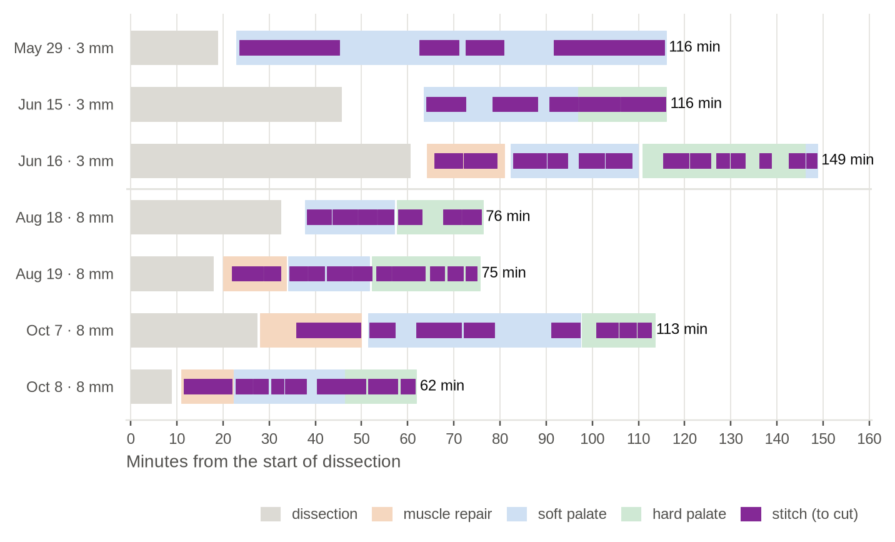
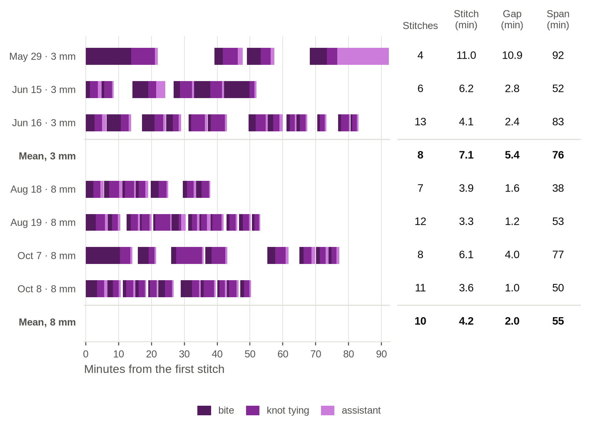
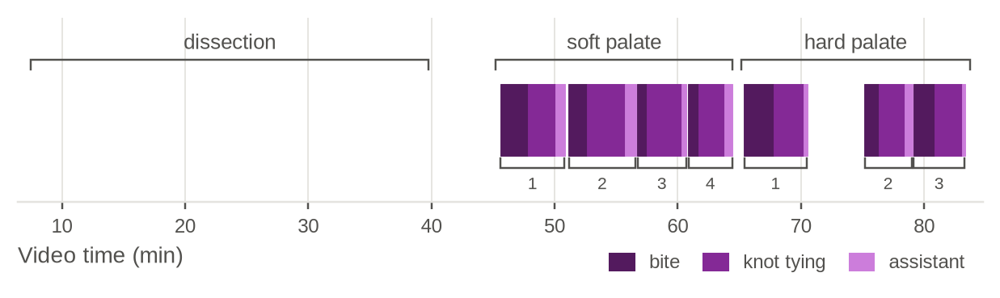
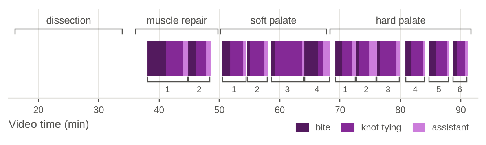
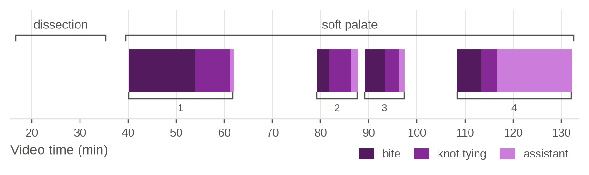

# Suture timing (draft)

Written by `scripts/suture_times.py` from `results/annotations/`; re-run it after new annotations.

## Procedure time

**Total procedure time.** One row per pig, from the start of dissection (0) to the cut of the last stitch; the number is the total in minutes. Shaded bars: annotated phases. Purple bars: stitches, from the needle first touching tissue to the assistant's cut.

| pig | system | total (min) | dissection (min) | first stitch to last cut (min) | stitches |
|---|---|---|---|---|---|
| May 29 | 3 mm | 116 | 19 | 92 | 4 |
| Jun 15 | 3 mm | 116 | 46 | 52 | 6 |
| Jun 16 | 3 mm | 149 | 61 | 83 | 13 |
| Aug 18 | 8 mm | 76 | 32 | 38 | 7 |
| Aug 19 | 8 mm | 75 | 18 | 53 | 12 |
| Oct 7 | 8 mm | 113 | 27 | 77 | 8 |
| Oct 8 | 8 mm | 62 | 8.8 | 50 | 11 |

Median per system:

| system | total (min) | dissection (min) | first stitch to last cut (min) | stitches |
|---|---|---|---|---|
| 3 mm | 116 | 46 | 83 | 6.0 |
| 8 mm | 75 | 23 | 52 | 9.5 |

## All pigs

**Stitch timelines, 3 mm vs 8 mm.** One row per pig, aligned at its first stitch. Each bar is one stitch, split into bite (dark purple, needle first touches tissue to needle through), knot tying (purple, needle through to last throw tightened) and assistant (light purple, tightened to the assistant's cut).

## All pigs, with numbers

**Stitch timelines with per-pig numbers.** Left: as above. Right: Stitches, number of stitches; Stitch, mean stitch time (needle first touches tissue to knot tightened); Gap, mean time from the end of one stitch (knot tightened) to the start of the next; Span, first stitch to last cut. Bold rows: mean of the pigs in each system.

## Aug 18 (`pig_aug18-2026-08-18_10.10.14`)

**Procedure timeline.** Brackets above: annotated phases. Each bar is one stitch, split into bite (dark purple, needle first touches tissue to needle through), knot tying (purple, needle through to last throw tightened) and assistant (light purple, tightened to the assistant's cut). Brackets below: each whole stitch, from the needle first touching tissue to the assistant's cut, numbered within each phase. (Stitch time in the tables is start to knot tightened.)

## Aug 19 (`pig_aug19-2026-08-19_12.09.17`)

**Procedure timeline.** Brackets above: annotated phases. Each bar is one stitch, split into bite (dark purple, needle first touches tissue to needle through), knot tying (purple, needle through to last throw tightened) and assistant (light purple, tightened to the assistant's cut). Brackets below: each whole stitch, from the needle first touching tissue to the assistant's cut, numbered within each phase. (Stitch time in the tables is start to knot tightened.)

## Jun 15 (`pig_jun15-2026-06-15_10.14.18`)

**Procedure timeline.** Brackets above: annotated phases. Each bar is one stitch, split into bite (dark purple, needle first touches tissue to needle through), knot tying (purple, needle through to last throw tightened) and assistant (light purple, tightened to the assistant's cut). Brackets below: each whole stitch, from the needle first touching tissue to the assistant's cut, numbered within each phase. (Stitch time in the tables is start to knot tightened.)

## Jun 16 (`pig_jun16-2026-06-16_09.57.53`)

**Procedure timeline.** Brackets above: annotated phases. Each bar is one stitch, split into bite (dark purple, needle first touches tissue to needle through), knot tying (purple, needle through to last throw tightened) and assistant (light purple, tightened to the assistant's cut). Brackets below: each whole stitch, from the needle first touching tissue to the assistant's cut, numbered within each phase. (Stitch time in the tables is start to knot tightened.)

## May 29 (`pig_may29-2026-05-29_09.34.18`)

**Procedure timeline.** Brackets above: annotated phases. Each bar is one stitch, split into bite (dark purple, needle first touches tissue to needle through), knot tying (purple, needle through to last throw tightened) and assistant (light purple, tightened to the assistant's cut). Brackets below: each whole stitch, from the needle first touching tissue to the assistant's cut, numbered within each phase. (Stitch time in the tables is start to knot tightened.)

## Oct 7 (`pig_oct07-2026-10-07_14.31.12`)

**Procedure timeline.** Brackets above: annotated phases. Each bar is one stitch, split into bite (dark purple, needle first touches tissue to needle through), knot tying (purple, needle through to last throw tightened) and assistant (light purple, tightened to the assistant's cut). Brackets below: each whole stitch, from the needle first touching tissue to the assistant's cut, numbered within each phase. (Stitch time in the tables is start to knot tightened.)

## Oct 8 (`pig_oct08-2026-10-08_13.19.52`)

**Procedure timeline.** Brackets above: annotated phases. Each bar is one stitch, split into bite (dark purple, needle first touches tissue to needle through), knot tying (purple, needle through to last throw tightened) and assistant (light purple, tightened to the assistant's cut). Brackets below: each whole stitch, from the needle first touching tissue to the assistant's cut, numbered within each phase. (Stitch time in the tables is start to knot tightened.)

## Summary per measure (seconds)

| block | measure | n | mean | SD | median | min | max |
|---|---|---|---|---|---|---|---|
| all blocks | stitch | 61 | 285 | 183 | 224 | 116 | 1265 |
| all blocks | bite | 61 | 131 | 141 | 80 | 28 | 832 |
| all blocks | knot tying | 61 | 154 | 74 | 134 | 45 | 473 |
| all blocks | assistant | 61 | 52 | 117 | 32 | 14 | 931 |
| all blocks | gap | 54 | 152 | 201 | 68 | 22 | 1082 |
| muscle repair | stitch | 7 | 370 | 212 | 338 | 182 | 815 |
| muscle repair | bite | 7 | 230 | 187 | 185 | 76 | 628 |
| muscle repair | knot tying | 7 | 140 | 30 | 137 | 106 | 186 |
| muscle repair | assistant | 7 | 44 | 16 | 39 | 27 | 69 |
| muscle repair | gap | 7 | 117 | 70 | 86 | 53 | 248 |
| soft palate | stitch | 30 | 321 | 209 | 285 | 116 | 1265 |
| soft palate | bite | 30 | 140 | 152 | 103 | 28 | 832 |
| soft palate | knot tying | 30 | 180 | 93 | 146 | 45 | 473 |
| soft palate | assistant | 30 | 71 | 165 | 32 | 15 | 931 |
| soft palate | gap | 28 | 203 | 262 | 68 | 22 | 1082 |
| hard palate | stitch | 24 | 216 | 107 | 177 | 125 | 553 |
| hard palate | bite | 24 | 91 | 95 | 65 | 28 | 460 |
| hard palate | knot tying | 24 | 124 | 35 | 111 | 84 | 213 |
| hard palate | assistant | 24 | 32 | 14 | 28 | 14 | 67 |
| hard palate | gap | 19 | 90 | 76 | 62 | 27 | 293 |

## Blocks

| video | block | duration (s) | stitches | time stitching (%) |
|---|---|---|---|---|
| pig_aug18-2026-08-18_10.10.14 | soft palate | 1158 | 4 | 80 |
| pig_aug18-2026-08-18_10.10.14 | hard palate | 1119 | 3 | 65 |
| pig_aug19-2026-08-19_12.09.17 | muscle repair | 825 | 2 | 65 |
| pig_aug19-2026-08-19_12.09.17 | soft palate | 1062 | 4 | 82 |
| pig_aug19-2026-08-19_12.09.17 | hard palate | 1408 | 6 | 68 |
| pig_jun15-2026-06-15_10.14.18 | soft palate | 2001 | 4 | 59 |
| pig_jun15-2026-06-15_10.14.18 | hard palate | 1150 | 2 | 92 |
| pig_jun16-2026-06-16_09.57.53 | muscle repair | 1005 | 2 | 69 |
| pig_jun16-2026-06-16_09.57.53 | soft palate | 1663 | 5 | 80 |
| pig_jun16-2026-06-16_09.57.53 | hard palate | 2124 | 6 | 55 |
| pig_jun16-2026-06-16_09.57.53 | soft palate | 147 | 5 | 909 |
| pig_may29-2026-05-29_09.34.18 | soft palate | 5588 | 4 | 47 |
| pig_oct07-2026-10-07_14.31.12 | muscle repair | 1314 | 1 | 62 |
| pig_oct07-2026-10-07_14.31.12 | soft palate | 2765 | 4 | 57 |
| pig_oct07-2026-10-07_14.31.12 | hard palate | 952 | 3 | 56 |
| pig_oct08-2026-10-08_13.19.52 | muscle repair | 672 | 2 | 81 |
| pig_oct08-2026-10-08_13.19.52 | soft palate | 1447 | 5 | 76 |
| pig_oct08-2026-10-08_13.19.52 | hard palate | 926 | 4 | 78 |

## Stitches (seconds)

| block | number | stitch | bite | knot tying | assistant | gap to next |
|---|---|---|---|---|---|---|
| soft palate | 1 | 268 | 135 | 133 | 49 | 66 |
| soft palate | 2 | 274 | 90 | 185 | 53 | 60 |
| soft palate | 3 | 215 | 45 | 169 | 26 | 33 |
| soft palate | 4 | 175 | 52 | 123 | 41 | 97 |
| hard palate | 1 | 292 | 143 | 149 | 17 | 293 |
| hard palate | 2 | 197 | 73 | 123 | 39 | 43 |
| hard palate | 3 | 239 | 105 | 134 | 15 |  |
| muscle repair | 1 | 354 | 185 | 169 | 52 | 53 |
| muscle repair | 2 | 182 | 76 | 106 | 39 | 156 |
| soft palate | 1 | 209 | 80 | 129 | 30 | 36 |
| soft palate | 2 | 176 | 30 | 145 | 31 | 67 |
| soft palate | 3 | 310 | 40 | 269 | 16 | 22 |
| soft palate | 4 | 180 | 135 | 45 | 72 | 126 |
| hard palate | 1 | 164 | 68 | 96 | 36 | 44 |
| hard palate | 2 | 133 | 28 | 105 | 67 | 71 |
| hard palate | 3 | 196 | 35 | 161 | 32 | 93 |
| hard palate | 4 | 169 | 55 | 113 | 24 | 63 |
| hard palate | 5 | 177 | 68 | 109 | 23 | 59 |
| hard palate | 6 | 125 | 42 | 84 | 19 |  |
| soft palate | 1 | 224 | 81 | 143 | 68 | 69 |
| soft palate | 2 | 185 | 46 | 139 | 29 | 379 |
| soft palate | 3 | 431 | 283 | 147 | 161 | 316 |
| soft palate | 4 | 335 | 117 | 218 | 31 | 41 |
| hard palate | 1 | 505 | 292 | 213 | 34 | 43 |
| hard palate | 2 | 553 | 460 | 94 | 32 |  |
| muscle repair | 1 | 298 | 161 | 137 | 69 | 86 |
| muscle repair | 2 | 399 | 256 | 143 | 37 | 248 |
| soft palate | 1 | 387 | 229 | 158 | 40 | 55 |
| soft palate | 2 | 226 | 122 | 104 | 34 | 178 |
| soft palate | 3 | 295 | 47 | 248 | 39 | 55 |
| soft palate | 4 | 314 | 57 | 258 | 33 | 435 |
| hard palate | 1 | 307 | 125 | 182 | 30 | 44 |
| hard palate | 2 | 211 | 92 | 118 | 54 | 131 |
| hard palate | 3 | 151 | 61 | 90 | 18 | 31 |
| hard palate | 4 | 165 | 55 | 109 | 24 | 213 |
| hard palate | 5 | 137 | 47 | 90 | 20 | 242 |
| hard palate | 6 | 202 | 50 | 151 | 14 | 27 |
| soft palate | 5 | 116 | 33 | 82 | 21 |  |
| soft palate | 1 | 1265 | 832 | 433 | 42 | 1082 |
| soft palate | 2 | 429 | 159 | 270 | 81 | 167 |
| soft palate | 3 | 432 | 254 | 178 | 65 | 717 |
| soft palate | 4 | 503 | 307 | 196 | 931 |  |
| muscle repair | 1 | 815 | 628 | 186 | 28 | 139 |
| soft palate | 1 | 305 | 194 | 111 | 23 | 302 |
| soft palate | 2 | 561 | 88 | 473 | 26 | 59 |
| soft palate | 3 | 368 | 120 | 249 | 29 | 766 |
| soft palate | 4 | 335 | 146 | 189 | 43 | 255 |
| hard palate | 1 | 218 | 72 | 145 | 61 | 82 |
| hard palate | 2 | 172 | 71 | 100 | 49 | 59 |
| hard palate | 3 | 144 | 47 | 97 | 40 |  |
| muscle repair | 1 | 338 | 208 | 131 | 59 | 62 |
| muscle repair | 2 | 203 | 94 | 109 | 27 | 76 |
| soft palate | 1 | 189 | 58 | 132 | 27 | 34 |
| soft palate | 2 | 180 | 65 | 115 | 15 | 61 |
| soft palate | 3 | 147 | 28 | 120 | 15 | 30 |
| soft palate | 4 | 255 | 125 | 131 | 21 | 156 |
| soft palate | 5 | 334 | 211 | 123 | 29 | 31 |
| hard palate | 1 | 242 | 55 | 187 | 26 | 62 |
| hard palate | 2 | 137 | 37 | 100 | 41 | 42 |
| hard palate | 3 | 176 | 35 | 141 | 24 | 69 |
| hard palate | 4 | 163 | 69 | 94 | 24 |  |

## Annotation checks

- May 29, soft palate stitch 4: 15.5 min from knot to cut; check the cut mark.
- Oct 8, soft palate stitch 5: 2 needle_through marks; the last one is used.
