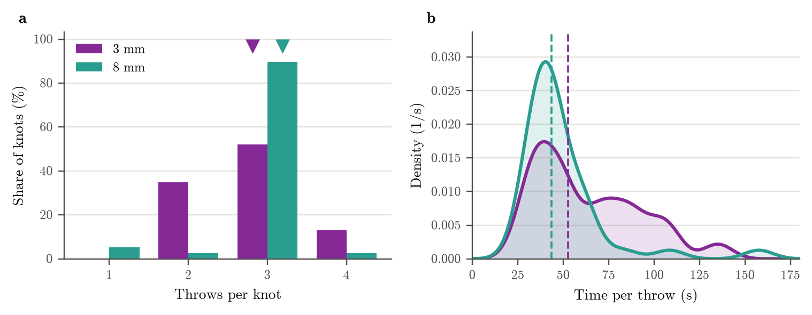

# Knot throws

Written by `scripts/knot_throws.py`; re-run it after new counts.

**Knot throws, 3 mm vs 8 mm.** (a) Share of knots by number of throws. (b) Time per throw: knot tying time (needle through to knot tightened) divided by the number of throws, shown as a probability density (Gaussian kernel 8 s wide; the area under each curve is 1). Purple: 3 mm (23 knots, 3 pigs). Teal: 8 mm (39 knots, 4 pigs). Triangles (a) and dashed lines (b): medians, 3 vs 3 throws and 53 s vs 44 s per throw. Throws were counted from video clips of each knot.

## Per system

| system | knots (pigs) | throws per knot | knot tying (s) | time per throw (s) |
|---|---|---|---|---|
| 3 mm | 23 (3) | 3 (2-3) | 147 (114-204) | 53 (38-84) |
| 8 mm | 39 (4) | 3 (3-3) | 123 (105-147) | 44 (36-52) |

Median (interquartile range). All knots of a system are pooled.

## Per case (medians)

| case | system | knots | throws | knot tying (s) | time per throw (s) |
|---|---|---|---|---|---|
| P01 | 3 mm | 4 | 2.0 | 233 | 103 |
| P02 | 3 mm | 6 | 2.5 | 145 | 60 |
| P03 | 3 mm | 13 | 3.0 | 137 | 48 |
| P04 | 8 mm | 7 | 3.0 | 134 | 50 |
| P05 | 8 mm | 13 | 3.0 | 106 | 36 |
| P06 | 8 mm | 8 | 3.0 | 166 | 55 |
| P07 | 8 mm | 11 | 3.0 | 123 | 44 |

## Knots by number of throws

| system | 1 throws | 2 throws | 3 throws | 4 throws |
|---|---|---|---|---|
| 3 mm | 0 | 8 | 12 | 3 |
| 8 mm | 2 | 1 | 35 | 1 |

## Limitations

Knot tying is timed from needle through to knot tightened, so it includes pulling the thread all the way through after the bite. With fresh, long suture this takes longer and is not throwing, so early knots and their time per throw are overestimated. The first knot of each block is slower:

| system | knot tying, first of block (s) | later (s) | time per throw, first of block (s) | later (s) |
|---|---|---|---|---|
| 3 mm | 170 | 143 | 65 | 48 |
| 8 mm | 133 | 117 | 44 | 41 |

Medians. Thread length was not recorded, so this is indirect evidence.
