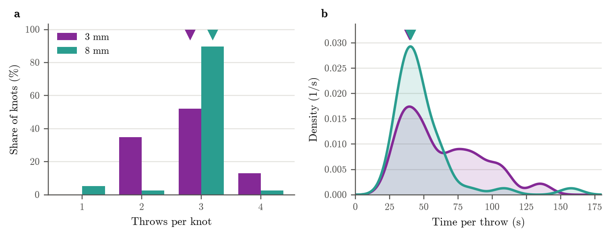

# Knot throws

Written by `scripts/knot_throws.py`; re-run it after new counts.

**Knot throws, 3 mm vs 8 mm.** (a) Share of knots by number of throws. (b) Time per throw: knot tying time (needle through to knot tightened) divided by the number of throws, shown as a probability density (Gaussian kernel 8 s wide; the area under each curve is 1). Purple: 3 mm (23 knots, 3 pigs). Teal: 8 mm (39 knots, 4 pigs). Triangles: most likely value, 3 vs 3 throws and 39 s vs 40 s per throw. Throws were counted from video clips of each knot.

## Per system

| system | knots (pigs) | throws per knot: most common | knot tying (s): peak | time per throw (s): peak |
|---|---|---|---|---|
| 3 mm | 23 (3) | 3 (median 3) | 144 (median 147) | 39 (median 53) |
| 8 mm | 39 (4) | 3 (median 3) | 107 (median 123) | 40 (median 44) |

Most likely value: the most common count for throws, and the main peak of the smoothed density for times. Medians alongside. All knots of a system are pooled. Secondary peaks are not reported: they change with the smoothing width and are not reliable with this many knots.

## Per pig (medians)

| pig | system | knots | throws | knot tying (s) | time per throw (s) |
|---|---|---|---|---|---|
| May 29 | 3 mm | 4 | 2.0 | 233 | 103 |
| Jun 15 | 3 mm | 6 | 2.5 | 145 | 60 |
| Jun 16 | 3 mm | 13 | 3.0 | 137 | 48 |
| Aug 18 | 8 mm | 7 | 3.0 | 134 | 50 |
| Aug 19 | 8 mm | 13 | 3.0 | 106 | 36 |
| Oct 7 | 8 mm | 8 | 3.0 | 166 | 55 |
| Oct 8 | 8 mm | 11 | 3.0 | 123 | 44 |

## Knots by number of throws

| system | 1 throws | 2 throws | 3 throws | 4 throws |
|---|---|---|---|---|
| 3 mm | 0 | 8 | 12 | 3 |
| 8 mm | 2 | 1 | 35 | 1 |

## Limitations

Knot tying is timed from needle through to knot tightened, so it includes pulling the thread all the way through after the bite. With fresh, long suture this takes longer and is not throwing, so early knots and their time per throw are overestimated. The first knot of each block is slower:

| system | knot tying, first of block (s) | later (s) | time per throw, first of block (s) | later (s) |
|---|---|---|---|---|
| 3 mm | 170 | 143 | 65 | 48 |
| 8 mm | 133 | 117 | 44 | 41 |

Medians. Thread length was not recorded, so this is indirect evidence.
